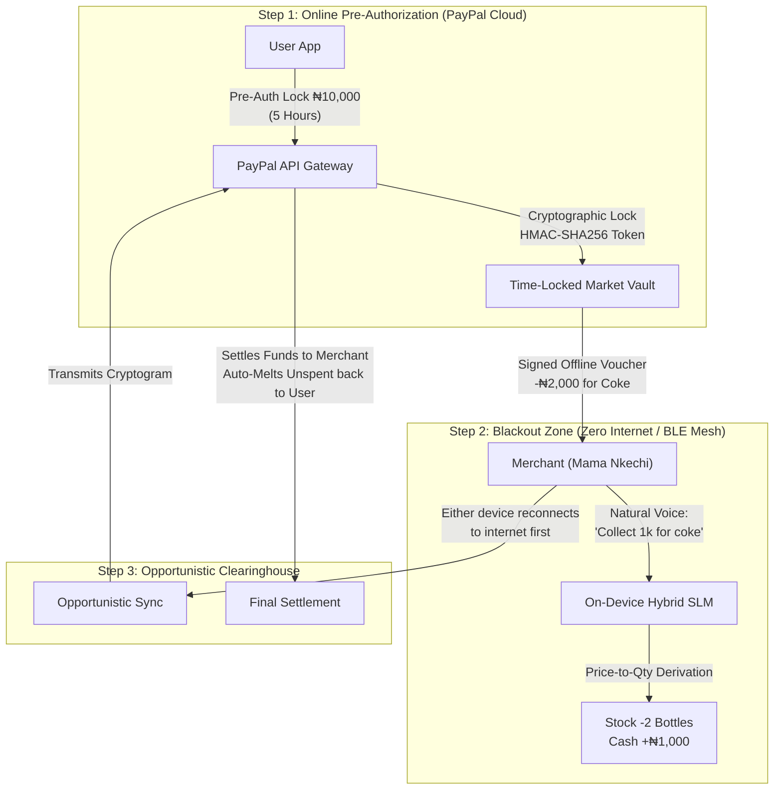

# T-Pay: Hybrid SLM & Time-Locked Offline Market Vault

> **Zero-connectivity mobile commerce & PayPal offline escrow engineered for Africa's blackout crisis.**

[](https://www.typescriptlang.org/)
[](https://react.dev/)
[](https://expo.dev/)
[](./DDD_ARCHITECTURE.md)
[-brightgreen?style=flat)](./core/__tests__/domain-verification.ts)
[](https://developer.paypal.com/)

---

## 🌍 1. The Reality: The African Blackout Crisis

In Nigeria and across sub-Saharan Africa, over **40% of digital point-of-sale transactions fail during grid outages and cellular network blackouts**. 

- **Merchant Reality**: Informal market traders (e.g. Mama Nkechi) juggle 3 to 5 clunky bank POS terminals hoping at least one has signal. When networks collapse, commerce reverts to unrecorded cash or stalls entirely.
- **Literacy Barrier**: Millions of market sellers cannot read or write spreadsheet formulas, making traditional accounting apps useless.
- **Double-Spend Fraud**: Existing "offline payment" attempts fail because unscrupulous actors double-spend their offline balances before syncing.

**T-Pay solves this with a dual-engine breakthrough**:
1. **The Time-Locked Market Vault ("The Budget-Locked Vault")**: Cryptographic pre-authorization on PayPal servers that completely eliminates offline double-spending.
2. **On-Device Hybrid Voice AI**: Natural speech recognition and audio readout in **Nigerian Pidgin, Yoruba, Igbo, Hausa, and English** that automates inventory deduction and physical cash audits without touching a spreadsheet.

---

## ⚡ 2. Core Architectural Pillars



### 1. The Time-Locked Market Vault ("The Big Gun")
- **Online Pre-Funding**: While connected, the user pre-authorizes an offline shopping budget (e.g., ₦10,000 for 5 or 24 hours). PayPal's cloud places a cryptographic pre-auth hold on the user's balance.
- **Zero Double-Spend**: Because the funds are locked on PayPal's servers, the user cannot spend that money elsewhere while offline. Every offline spend produces an HMAC-SHA256 voucher verified against the pre-auth.
- **Opportunistic Clearinghouse**: Whichever peer reconnects to the internet first transmits the cryptogram to PayPal APIs for settlement.
- **Auto-Melt Guarantee**: When the timer expires, any unspent funds automatically dissolve back into the user's primary PayPal checking account.

### 2. Zero-Literacy Hybrid Voice AI
- Runs locally offline via **Mobile SLM (Small Language Model)** with online Gemini cloud fallback.
- Native dialect comprehension for **Nigerian Pidgin, Yoruba, Igbo, Hausa, and English**.
- **Spoken Audio Readout**: Closes the literacy gap by speaking confirmations, inventory levels, and reconciliation summaries aloud so informal traders never need to read a screen.

### 3. The 3 Specification Demo Personas
- **Case 1: Mama Nkechi Provisions (Market Trader)**
  - Natural voice sale: *"Collect 1k for coke"*.
  - AI calculates price-to-quantity: ₦1,000 ÷ ₦500 unit price = auto-deducts 2 bottles from stock and logs ₦1,000 cash.
  - Spoken inventory sheet setup: *"Coke, 42 packs, 500 naira for 1; Maltina, 56 packs, 600 for 1"*.
  - Interactive **End-of-Day Physical Stock Audit & Cash Reconciliation** modal with spoken review.
- **Case 2: Salary Earner (Personal Budgeting)**
  - Budgets for Food (₦60k), Transport (₦30k), and Upkeep (₦40k).
  - *"Send 2k for spag"* auto-categorizes under Food budget with a note.
  - Conversational ambiguity resolution: *"Send 5k for sneakers"* prompts the user: *"Does this fall under Food, Transport, or Upkeep?"* with 1-tap classification.
- **Case 3: Morufu Transport (7-Seater Korope Mini-Bus)**
  - Driver announces *"Collect money from everybody"*.
  - Proximity Bluetooth BLE mesh sweeps all passenger devices.
  - Audio alert to driver: *"5 passengers have paid. You have 2 seats left."*

---

## 🏗️ 3. Clean Architecture & Domain-Driven Design (DDD)

The codebase strictly adheres to DDD Clean Architecture in [`core/`](./core/):

```
core/
├── banking/              # BankAccount Aggregate, Balance Value Object
├── escrow/               # Time-Locked Market Vault & Offline Escrow Tokens
│   ├── domain/           # MarketVault Aggregate Root, Domain Events
│   ├── application/      # LockMarketVaultUseCase, MeltMarketVaultUseCase
│   └── infrastructure/   # LocalStorage & PayPal Gateway Adapters
├── resource-tracking/    # Smart Resource Tracking
│   ├── merchant/         # InventoryItem Aggregate, Price-to-Quantity derivation
│   ├── budget/           # MonthlyBudget Aggregate, Ambiguity Resolver
│   └── transit/          # KoropeTrip Aggregate (7-Seater Manifest)
├── assistant/            # Hybrid SLM NLP Parser, Speech Synthesis Adapter
└── __tests__/            # Verification suite (9/9 domain tests passing)
```

To run the architectural domain verification suite:
```bash
node --loader ./ts-loader.mjs core/__tests__/domain-verification.ts
```

---

## 🚀 4. Quickstart Guide

### Option A: React Web Application (Vite + Tailwind CSS)

```bash
# 1. Install dependencies
npm install

# 2. Launch development server
npm run dev
```
Open **[http://localhost:3000](http://localhost:3000)** in your browser.

### Option B: React Native Mobile App (Expo)

```bash
# 1. Navigate to the mobile app directory
cd react-native-app

# 2. Start the Expo development server
npm start
# or: npx expo start --web
```

---

## 🏆 5. Judge Interactive Demo Walkthrough (5-Minute Tour)

For hackathon judges evaluating T-Pay:

1. **The Header & Pitch Hub**:
   - Tap **"🏆 Pitch Hub"** in the top header or hamburger menu.
   - Explore the **Pitch Deck**, the **3 Live Cases**, the **Vault Architecture**, and the **B2B Strategy**.
2. **Experience the Market Vault ("The Big Gun")**:
   - Tap **"🛡️ Vault"** in the top navigation.
   - Select **₦10,000** budget and **5 Hours** duration.
   - Tap **"Lock ₦10,000 on PayPal"** to see live countdown, HMAC-SHA256 hash, and PayPal Pre-Auth ID.
   - Tap **"Simulate Spend ₦2,000 at Mama Nkechi"** to see offline cryptographic voucher creation.
   - Tap **"Auto-Melt Unspent"** to see unspent funds return to checking balance.
3. **Experience the 3 Smart Resource Tracker Personas**:
   - Switch to the **Tracker** tab:
     - **Mama Nkechi**: Tap *"Collect 1k for coke"* to see price-to-quantity derivation (-2 bottles Coke, +₦1,000 cash). Tap *"Daily Stock Review & Audit"* to hear spoken reconciliation.
     - **Salary Budget**: Tap *"Send 2k for spag"* to see auto-budget tagging. Tap *"Send 5k for sneakers"* to test conversational ambiguity resolution.
     - **Morufu Korope**: See the 7-seat mini-bus manifest. Tap *"Collect money from everybody"* to run the Bluetooth proximity sweep and fill the manifest.
4. **Experience the Multilingual Voice Assistant**:
   - Long-press the center circular button with opposing half-barb arrows.
   - Switch dialects between **🇳🇬 Pidgin, 🇬🇧 English, 🇳🇬 Yoruba, 🇳🇬 Igbo, and 🇳🇬 Hausa**.
   - Tap any voice scenario to trigger audio speech synthesis read aloud.

---

## 📈 6. Commercial Strategy: Ecosystem to Open B2B Protocol

- **Phase 1 (Hackathon Launch)**: Closed-loop ecosystem launch for PayPal wallet holders. Gives T-Pay users exclusive access to the Secure Offline Budget Vault.
- **Phase 2 (Africa Scale)**: Package T-Pay's Dual-App Trust & Opportunistic Settlement into an open B2B Infrastructure API licensed to Tier-1 African fintechs (**Moniepoint, OPay, PalmPay**) to eradicate hardware POS terminal bloat forever.

---

## 📄 License
MIT © 2026 T-Pay Team.
